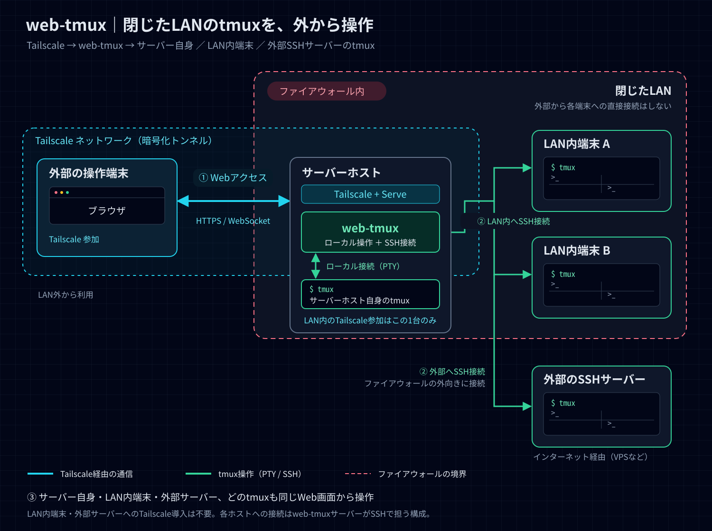

# web-tmux

[tmux](https://github.com/tmux/tmux) の軽量 Web フロントエンドです。Tailscale Serve 経由のブラウザから tmux セッションを操作でき、モバイルにも対応しています。

```
Browser (xterm.js)  ←─WebSocket─→  server.py  ←─PTY─→  tmux -CC
```

[English](README.md)

## ネットワーク構成



ファイアウォールで保護された閉じたLAN内に、web-tmuxサーバーを配置する構成例です。

1. Tailscaleに参加している操作端末のブラウザから、**Tailscale Serve** 経由（HTTPS / WebSocket）でweb-tmuxにアクセスします。
2. web-tmuxから、**サーバーホスト自身のtmux** はローカルPTY経由で、**LAN内の別端末のtmux** やファイアウォールの外にある **外部のSSHサーバー**（VPSなど）のtmuxはSSH経由で操作できます。
3. LAN内でTailscaleに参加するのはサーバーホスト1台のみです。ほかのLAN内端末や外部サーバーへのTailscale導入は不要で、ブラウザは各端末に直接接続せず、web-tmuxだけに接続します。

SSH接続先の設定は[他のホストの tmux（SSH）](#他のホストの-tmuxssh)を参照してください。

## 主な機能

- セッション・ウィンドウ・ペインをサイドバーにリアルタイム表示
- セッション・ウィンドウのインライン切り替え・リネーム・削除
- 新規ウィンドウ・セッション作成、ペインの縦横分割
- ペインズームの切り替え（サイドバーのペインを選択してズーム、再選択で解除）
- ブラウザのビューポートに合わせた端末の自動リサイズ
- カラーテーマ切り替え：Dark（デフォルト）/ Light / Nord
- フォントサイズ調整（11〜18 px）、設定は `localStorage` に保存
- 今開いている全セッションの構成（ウィンドウ名・分割レイアウト・各ペインの作業ディレクトリ）を名前を付けて保存し、あとから復帰
- 閲覧専用のファイルビューア：ペインの作業ディレクトリから辿ってテキストファイルを表示し、Markdown はプレビュー表示。画像（PNG / JPEG / GIF / WebP / AVIF / BMP / ICO / SVG）も表示でき、Markdown 内で同じホストの画像を参照していればそれも表示します（トップバーのフォルダアイコン、またはサイドバーのペインのフォルダボタン）。SSH 接続先でも使えます。テキストは 200 KiB まで、画像は 4 MiB までで、開けるのは通常ファイルのみ
- Claude Code / Codex / Hermes Agent が動いているペインの状態をサイドバーにアイコンで表示：プロンプト（`❯_`）＝待機中、青の回転矢印＝思考中、橙の警告（点滅）＝承認待ち・選択待ち（Hermes のモデル選択など）。ウィンドウ行とセッション行には、その中で一番急ぐ状態を表示します。サーバーが約 2 秒ごとにペインの画面下部を読み、各エージェントの表示（`esc to interrupt`、`Do you want to proceed?` など）で判定します。設定は不要ですが、対象は今見ているホストだけで、エージェントが表示の文言を変えると判定が外れることがあります
- **モバイル対応：** アクティブペイン全画面表示、仮想キーボード（Esc / Ctrl / Tab / Enter / 矢印）、IME 入力対応

## 必要環境

- Python 3.10 以上
- tmux
- モダンブラウザ（Chrome / Safari / Firefox）

Python 環境は `setup.sh` が自動で構築します。既に [uv](https://github.com/astral-sh/uv) があれば `uv.lock` から `uv sync --frozen` で同期し、なければ既存の Python 3.10+ と `venv` + `pip` を使用します。`setup.sh` 自体がuvをダウンロードしたり、`curl | sh` を実行したりすることはありません。

ブラウザ端末のアセットは `static/vendor/` に同梱しているため、実行時に
CDN 接続は不要です。

## インストール

### macOS

```bash
brew install tmux
git clone https://github.com/solab-tut/web-tmux.git
cd web-tmux
./setup.sh    # .venv を作成して依存パッケージをインストール
cp .web-tmux.env.example .web-tmux.env && chmod 600 .web-tmux.env
# .web-tmux.env のTailnet HTTPS OriginとTailscaleログイン名を編集
./server.sh   # サーバーを起動
```

### Linux（Ubuntu 22.04 / 24.04）

```bash
sudo apt install tmux
git clone https://github.com/solab-tut/web-tmux.git
cd web-tmux
./setup.sh    # .venv を作成して依存パッケージをインストール
cp .web-tmux.env.example .web-tmux.env && chmod 600 .web-tmux.env
# .web-tmux.env のTailnet HTTPS OriginとTailscaleログイン名を編集
./server.sh   # サーバーを起動
```

### Linux（Ubuntu 20.04）

Ubuntu 20.04 のデフォルト Python は 3.8 です。先にPython 3.10+をインストールするか、[公式手順](https://docs.astral.sh/uv/getting-started/installation/)でuvを別途導入してください。Pythonを手動でインストールする場合:

```bash
sudo add-apt-repository ppa:deadsnakes/ppa
sudo apt update
sudo apt install tmux python3.10 python3.10-venv
git clone https://github.com/solab-tut/web-tmux.git
cd web-tmux
./setup.sh
cp .web-tmux.env.example .web-tmux.env && chmod 600 .web-tmux.env
# .web-tmux.env のTailnet HTTPS OriginとTailscaleログイン名を編集
./server.sh
```

[Tailscaleの設定](#tailscale-を使ったリモートアクセス)を完了してから、ブラウザでTailnetのHTTPS URLを開きます。localhost経由の直接アクセスは意図的に無効化しています。

### 起動・停止オプション

**tmux セッション名を変更する**（デフォルト: `web`）:

```bash
TMUX_SESSION=my-session ./server.sh
```

**起動・停止:**

```bash
./server.sh        # 起動（起動中なら再起動）
./server.sh start  # 同上
./server.sh restart # 明示的に再起動
./server.sh stop   # 停止のみ（再起動しない）
```

`server.sh` は、このチェックアウトのサーバーと確認できるプロセスだけを停止します。Linuxでは、PIDファイルが失われたり古くなった場合も、`/proc` の所有者・作業ディレクトリ・起動引数を確認して停止できます。無関係なPIDは停止せず、別のチェックアウトやアプリが8765/8766を使用している場合は、そのプロセスをkillせず起動を中止します。

## 使い方

### サイドバー操作

| セクション | 操作 |
|-----------|------|
| **Sessions** | クリックで切り替え、✏ でリネーム、🗑 で削除 |
| **Windows** | クリックで切り替え（ズーム中のウィンドウは自動解除） |
| **Panes** | アクティブなペインをクリック → ズームのオン／オフ切り替え、別のペインをクリック → そのペインへズーム |
| **❯_ / ↻ / ⚠**（行頭のアイコン） | AI エージェントの状態：待機中／思考中／承認・選択待ち。マウスを乗せるとエージェント名と状態を表示 |
| **+**（Windows 行） | 現在のセッションに新規ウィンドウを追加 |
| **+**（Sessions 行） | 新規セッションを作成（ssh ホストがない場合。ある場合は各ホスト行の **+**） |
| **ホスト行**（ssh ホスト設定時） | クリックでそのホストのセッションを折り畳み／展開 |

Windows と Panes は現在のセッションの中身なので、`ホスト › セッション` の見出しを付けた1つの枠にまとめて表示します。
| **⇿ / ⇕** | アクティブペインを横分割 / 縦分割 |
| **Layouts** | クリックで保存済みレイアウトを復帰、🗑 で削除 |
| **+**（Layouts 行） | 今開いている全セッションを1つの名前にまとめて保存 |

レイアウトは、保存した時点で開いていた全セッションのワークスペース全体のスナップ
ショットです — 各セッションのウィンドウ名、ペインの分割の仕方、各ペインの作業ディレ
クトリを記録します。実行中だったコマンドや画面の内容は保存されないので、復帰すると
同じセッション・同じ枠組みに新しいシェルが並びます。保存時の作業ディレクトリが失わ
れていた場合は `$HOME` にフォールバックします。

復帰は各セッションを保存時の名前で行います。いずれかの名前のセッションが既に動いて
いる場合は、**Replace**（衝突しているものだけ既存を破棄して置き換え）、
**Restore as copy**（衝突しているものだけ空いている名前で並べて復帰）、
**Skip existing**（衝突しているものは無視し、それ以外だけ復帰）、**Cancel** のいずれか
を選ぶダイアログが出ます — この選択は衝突しているセッション全体に一括で適用されます。
衝突していないセッションはいずれの復帰方法でもそのまま復帰されます。各セッシ
ョンはまず一時的な名前で個別に組み立てられるため、あるセッションの復元に失敗しても
他のセッションや既存のセッションに影響しません。復元できなかったセッションがあれば
サイドバーに一言表示されます。

レイアウトの保存先は `~/.local/share/web-tmux/layouts.json` です（[セキュリティ](#セキュリティ)を参照）。

### テーマとフォントサイズ

トップバー右端の **◑**（テーマ）または **Aa**（フォントサイズ）アイコンをクリックするとドロップダウンが開きます。設定は `localStorage` に保存され次回訪問時も維持されます。

| テーマ | 説明 |
|--------|------|
| Dark   | VS Code Dark 風ダークテーマ（デフォルト） |
| Light  | 明るい背景のライトテーマ |
| Nord   | Nordic カラーパレットのダークテーマ |

フォントサイズ：11 / 12 / 13 / 14 / 16 / 18 px

### マウスを使うアプリからのコピー

マウス操作をアプリ側で受け取るもの（Claude Code のフルスクリーン表示、`mouse=a` の vim、tmux のコピーモード）は、ブラウザの選択ではなく tmux のペーストバッファにコピーします。web-tmux は新しいペーストバッファを、フォーカスのあるブラウザの OS クリップボードへ転送します。Chrome / Edge ではそのまま書き込まれます。ブラウザが書き込みを拒否した場合（Safari、Firefox）は、右下に **Copy N characters** ボタンが 10 秒間表示されるので、クリックするとコピーが完了します。128 KiB を超えるバッファは転送しません。

### モバイル操作

画面幅 768 px 以下の場合:

- アクティブなペインのみ全画面表示されます
- **☰** ボタンでサイドバーを開閉できます
- トップバーの **Paste** アイコンは貼り付けシートを開きます。入力欄を長押しして貼り付け、**Send to terminal** で送信します

**下部ツールバー**（仮想キー：`Esc`、`Ctrl`、`Tab`、`Enter`、矢印キー）は、画面幅に関係なくタッチ操作に対応した端末で自動表示されます。この判定にはタッチ入力の有無を使うため、デスクトップ表示のユーザーエージェントを使う iPad / iPadOS も対象になります。トップバーのキーボードアイコンから次の表示モードを選択でき、設定は次回訪問時も維持されます。

- **Auto** — タッチ端末または画面幅 768 px 以下で表示（デフォルト）
- **On** — 常に表示
- **Off** — 常に非表示

`Ctrl` トグルを有効にすると次の 1 文字に Ctrl 修飾を適用します。なお、この設定が切り替えるのは web-tmux の仮想キーツールバーであり、iOS / iPadOS 自体のソフトキーボードではありません。

iOS / iPadOS では、ソフトキーボードの上に鍵・カード・位置情報アイコンの AutoFill バー（入力アクセサリビュー）が出ます。これはパスワード欄に限った表示ではなく、フォーム要素にフォーカスが当たっていれば常に出るもので、xterm.js の隠し `<textarea>` にフォーカスするターミナルも対象になります。**ページ側からこれを消す方法はありません** — 上書きできるのはネイティブの `WKWebView` ホストが持つ `inputAccessoryView` だけで、端末設定にも無効化する項目はありません。`autocomplete="off"` は `static/app.js` で設定済みですが WebKit は無視します。実機（iOS 26）で `<form>` 囲み、`input type` 各種、`contenteditable`、`inputmode` 各種、画面外配置など 12 通りを試しましたが、どれでもバーは出たままでした。

iOS がタブを破棄したあと、Safari はそのタブを履歴ナビゲーションとして復元します。このとき WebKit は、ページの読み込みが完了していて保留中の要求が何も無くても「読み込み中」表示を残し続けます。そこで復元されたタブは、接続が確立した時点で通常のナビゲーションとして自分を読み込み直します（Service Worker がキャッシュから返すのでネットワークは使いません）。`static/app.js` の `RENAVIGATE_RESTORED_TABS = false` にすれば、読み込み表示は残りますが復元されたタブをそのまま使えます。

## 他のホストの tmux（SSH）

web-tmux は、他のマシンで動いている tmux にも接続できます。tailnet に参加していない LAN 内のマシンも、tailnet ノードを `ProxyJump` の踏み台にすれば対象にできます。ブラウザが話す相手はこれまでどおりこのサーバーだけで、サーバーが `ssh <alias> tmux -CC` を実行します。リモートの tmux はローカルと同じようにサイドバーに並び、ウィンドウ、ペイン、スクロールバック、レイアウト保存がそのまま使えます。ブラウザ、このサーバー、ssh 接続のどれが切れても、セッションはリモート側で動き続けます。

**1. 接続方法をサーバーユーザーの `~/.ssh/config` に書く。** 認証は次のどれでも使えます。

- パスフレーズなしの鍵（最も簡単。専用鍵を推奨）
- ssh-agent に登録した鍵（`server.sh` は、ログインシェルや `.web-tmux.env` に設定した `SSH_AUTH_SOCK` をそのまま渡します）
- パスフレーズ付きの鍵、またはパスワード（ブラウザで入力します。後述の「サインイン」を参照）

```
Host gw-home                      # LAN 内の tailnet ノード
  HostName gw-home.tailnet-name.ts.net
  User me
  IdentityFile ~/.ssh/web-tmux_ed25519
  IdentitiesOnly yes

Host lan-box                      # LAN のみ（tailnet 外）
  HostName 192.168.1.20
  User me
  ProxyJump gw-home
  IdentityFile ~/.ssh/web-tmux_ed25519
  IdentitiesOnly yes
```

**2. 一度手動で接続し**、両方のホップを `known_hosts` に登録します。web-tmux は未知のホスト鍵を受け入れない（`StrictHostKeyChecking=yes`）ため、未登録だと「到達不能」として扱われます。

```bash
ssh lan-box tmux -V
```

**3. `.web-tmux.env` にエイリアスを列挙して**再起動します。

```bash
WEB_TMUX_SSH_HOSTS=lan-box,mac-mini:/opt/homebrew/bin/tmux
```

使えるのはここに列挙したエイリアスだけです。ブラウザはこの中から選ぶだけで、任意のホストを指定することはできません。`alias:/path` は、非対話の ssh ログインの PATH に tmux が無い場合（macOS の Homebrew など）に tmux のパスを指定します。ブラウザからのサインインには、このマシンに OpenSSH 8.4 以上が必要です。

**使い方。** ホストを設定すると、セッション一覧がホストごとにまとまります。各ホストには名前の後ろに状態ドット、そのホストに新規セッションを作る **+**、到達不能なホストを再確認する **↻** が付きます。他ホストのセッションを選ぶと、サーバーの control client がそのホストに移ります。すべてのブラウザが同じ client を見ているので、開いている全ブラウザが一緒に移ります。リモートにいる間、トップバーには `server → alias` と表示されます。接続が切れて再接続できない場合は、ローカルのセッションに戻り、その旨を表示します。レイアウト保存では、応答したすべてのホストのセッションを記録します（応答しないホストは除外し、どのホストを除外したかを表示します）。復元では各セッションを元のホストに再構築します。別ホストへ自動で切り替えることはなく、到達できないホストのセッションは個別に失敗として報告します。

**サインイン。** パスフレーズやパスワードが必要なホストは、一覧に 🔑 が表示されます。🔑 をクリックするか、そのホストの **+** やセッションを選ぶと、操作したブラウザにだけ ssh 自身のプロンプト（`Enter passphrase for key …`、`me@lan-box's password:`）が表示されます。ProxyJump の踏み台でも必要なら、ホップごとに順に聞かれます。入力した文字列は WebSocket から `SSH_ASKPASS` 経由でそのまま ssh に渡され、保存もログ出力もされません。Cancel でサインインを中止できます。サインイン後の共有接続は最後の利用から 8 時間維持されるので、その間は再入力不要です（web-tmux は停止・再起動時に ssh 接続を閉じます。強制終了などで残った接続も、次の起動時に閉じます）。セッション一覧の背景更新がプロンプトを出すことはなく、パスワードが必要なホストは誰かがサインインするまで 🔑 のままです。

**切断。** 接続中のリモートホストには、切れたリンクの形の切断ボタンも付きます。押すとそのホストへの共有 ssh 接続を閉じます。control client がそのホストにいる場合は、先に全ブラウザをローカルのセッションに戻します。ホスト上の tmux セッションはそのまま動き続けます。切断したホストは灰色のドットになり、リンクの形の接続ボタンを押して接続するまで（必要ならパスフレーズやパスワードを聞きます）背景での確認も行いません。切断状態は web-tmux を再起動すると解除されます。

**リモート側の要件：** tmux 3.2 以上（3.2/3.3 では prefix キーは tmux のバインドとして扱われず、そのままペインに送られます）、POSIX 系のログインシェル（sh/bash/zsh。fish は不可）、UTF-8 が使える環境。接続時にリモート tmux サーバーのグローバルオプション `window-size latest` と `history-limit 50000` を設定します（ローカルと同じ）。

ホストへの ssh 呼び出しは 1 本の接続を共有します（`ControlMaster`、10 分間維持）。ソケットとホストごとの ssh ログは `~/.local/share/web-tmux/ssh/` に置かれます。

## Tailscale を使ったリモートアクセス

[Tailscale Serve](https://tailscale.com/kb/1312/serve) を使うと、web-tmux を Tailnet 内のデバイスから HTTPS で利用できます。web-tmux は署名付きセッションCookieを発行する前に、ブラウザのOriginと `Tailscale-User-Login` ヘッダーを検証します。

### 仕組み

web-tmux は 2 つのローカルポートを使用します:

| ポート | 用途 |
|--------|------|
| 8766 | 静的ファイル（HTTP） |
| 8765 | WebSocket 端末 I/O |

両方を `tailscale serve` で公開する必要があります。ページが HTTPS で配信されると、ブラウザは WebSocket 接続を自動的に `wss://` へ切り替えます。

### 設定

`.web-tmux.env` を作成して権限を600に保ち、TailnetのHTTPS OriginとTailscaleログイン名だけを設定します:

```dotenv
WEB_TMUX_ALLOWED_ORIGINS=https://<machine>.<tailnet>.ts.net:8766
WEB_TMUX_TAILSCALE_USERS=you@example.com
```

`server.sh` は権限が正確に600でない場合、`.web-tmux.env` を読み込まず起動を中止します。`WEB_TMUX_*` の設定はこのファイルからだけ読み、シェルの環境変数にあるものは無視するので、別のチェックアウト用に export した設定が混ざることはありません。Originが空の場合や、リモートOriginに対するTailscaleログイン名がない場合も起動を拒否します。localhostや `127.0.0.1` は追加せず、ブラウザからはTailscale Serve経由だけで利用してください。

| 設定名 | 内容 |
|--------|------|
| `WEB_TMUX_ALLOWED_ORIGINS` | 許可するHTTP Originのカンマ区切り完全一致リスト |
| `WEB_TMUX_TAILSCALE_USERS` | 許可する `Tailscale-User-Login` のカンマ区切り完全一致リスト |

`.web-tmux.env` を編集したらサーバーを再起動します:

```bash
./server.sh stop && ./server.sh start
```

続けて両方のポートを `tailscale serve` で公開します:

```bash
tailscale serve --bg --https=8766 http://127.0.0.1:8766
tailscale serve --bg --https=8765 http://127.0.0.1:8765
```

> **Linux の場合：** `tailscale serve` には `sudo` が必要です。macOS では通常不要です。

以下の URL でアクセスできます:

```
https://<machine-name>.<tailnet>.ts.net:8766/
```

### 確認

```bash
tailscale serve status
```

以下のような出力が得られれば正常です:

```
https://<machine-name>.<tailnet>.ts.net:8765/ (tailnet only)
|-- / proxy http://127.0.0.1:8765

https://<machine-name>.<tailnet>.ts.net:8766/ (tailnet only)
|-- / proxy http://127.0.0.1:8766
```

### 停止

```bash
tailscale serve --https=8766 off
tailscale serve --https=8765 off
```

> **Linux の場合：** こちらのコマンドにも `sudo` が必要です。

### Tailscale Funnel による外部公開

**web-tmux では Funnel を有効にしないでください。** 本アプリは本人所有の非公開Tailnet専用です。インターネット公開と複数ユーザー向け認可はセキュリティモデルの対象外です。

## セキュリティ

- サーバーは `127.0.0.1` にのみバインドし、許可Originからlocalhostを除外することで、ブラウザアクセスをTailscale Serve経由に限定します。ただしループバック待受はホスト境界であってユーザー境界ではなく、別のローカルUnixユーザーはプロキシヘッダーを偽装できるため、信頼できないローカルユーザーがいない個人用マシンを前提とします。
- HTTPとWebSocketは許可済みHost／Originを必須とし、Tailnet接続では許可済みの `Tailscale-User-Login` も検証します。
- Tailscale IDの検証後、`GET /auth/session` がHttpOnly、SameSite=Strict、HMAC署名付きCookieを自動発行します（有効期限30日）。ページは初回ロード時に取得し、接続が安定してから更新し、ハンドシェイクが拒否されたとき（署名鍵が作り直されるサーバー再起動後など）に再取得します。モバイルのスリープ復帰を含む再接続ではCookieを再利用し、HTTPリクエストを一切出しません。Tailnet HTTPSではSecure属性も付きます。
- Origin欠落、Host不一致、Cookie不正、未許可ユーザーは、tmux状態を生成する前に拒否します。Tailscale IDヘッダーを持たないタグ付き端末も利用できません。
- WebSocketは最大8接続、1メッセージ64 KiB、入力1メッセージ8 KiBに制限され、圧縮は無効です。操作・入力レートと送信キューにも上限があります。
- CSP、フレーム埋め込み禁止、MIME sniffing防止、Referrer／Permissions PolicyをHTTPレスポンスに付与します。
- Service Worker（`static/sw.js`）がアプリ本体をキャッシュし、ブラウザが破棄済みタブを作り直すときに自分で出すドキュメント要求に応答します。この読み込みがネットワークを待つことはありません。`/auth/session` には一切触れず、キャッシュにはアプリ本体しか入りません（端末の内容はWebSocket側にしか流れず、そちらの認証はそのままです）。認可が外れたブラウザでもキャッシュされた画面は開けますが、接続はできません。
- `no-store` はCookieを発行する応答だけに付けます。アプリ本体は毎回再検証、`/vendor/` 配下のバージョン付きファイルはキャッシュ可能にしてあり、ブラウザがネットワークに戻らずページを復元できます（いずれも端末の内容や秘密情報を含みません）。
- 不正なOrigin、ID、メッセージ、レート超過は、端末入力やCookie値を含めず `server.log` に記録します。再接続時にはページが接続状態の短い診断行（`client ...`）も記録します。端末の内容は含みません。不要なら `static/app.js` の `CLIENT_DIAGNOSTICS = false` で止められます。
- 保存したレイアウトは `~/.local/share/web-tmux/layouts.json` に、モード700のディレクトリ内でモード600のファイルとして書き出されます。作業ディレクトリのパスを含むため機密として扱ってください。ネットワークには出ず、リポジトリにも含まれません。
- `tailscale serve status` が上記2ポートのtailnet-only公開だけになっていることを維持してください。
- `WEB_TMUX_SSH_HOSTS` を設定した場合、web-tmux に入れた人（許可済みTailscale ID、または盗まれたセッションCookie）は、列挙した全ホストと途中の踏み台ホストでシェルを得られます。tmux 自体が任意のコマンドを実行できるため `command=` による鍵の制限は効きません。ただし各リモートの `authorized_keys` に `restrict,pty,from="<このサーバーのtailnet IP>"` を付ければ、鍵の他所での利用やフォワーディングを防げます。ssh は agent／X11 フォワーディングを無効にし、設定済みのフォワーディングもすべて解除して実行します。ssh ソケットのディレクトリはモード700です。サインイン画面で入力したパスフレーズやパスワードは、認証済みの WebSocket からモード600のソケットを経て ssh に渡るだけで、ディスクにもログにも残りません。プロンプトに答えられるのはサインインを始めたブラウザだけです。ssh は制御端末なしで、サインイン以外のプロンプトをすべて拒否する askpass 付きで動きます。リモートのエラー文は（短く1行にして）ログに残しますがブラウザには送らず、端末の内容はログに残しません。

## サードパーティのブラウザアセット

- `xterm@5.3.0`
- `xterm-addon-fit@0.8.0`
- `xterm-addon-unicode11@0.4.0`
- `markdown-it@14.1.0`（同梱の依存パッケージのライセンスは、BSD-2-Clause の
  `entities` を含め、同じ場所の `THIRD_PARTY_LICENSES` にあります）

これらのアセットは MIT ライセンスで配布されています。ライセンスファイルは
`static/vendor/` 内の各 vendored ファイルの近くに同梱しています。

## ファイル構成

```
web-tmux/
├── server.py             # HTTP + WebSocket サーバー
├── web_security.py       # Origin、Host、ID、署名Cookieの検証
├── tmux_control.py       # tmux -CC 制御モードラッパー
├── askpass.py            # ssh のパスフレーズ／パスワードをブラウザで答える仕組み
├── tmux_hosts.py         # ローカル／ssh ホスト：tmux の argv、ssh マスター、ホスト一覧
├── layout_parser.py      # tmux レイアウト文字列パーサー
├── layout_store.py       # セッション構成の保存・復元計画・ストア
├── agent_status.py       # ペインの画面から AI エージェントの状態を判定
├── test_security.py      # 認証・検証・制限のテスト
├── test_server.py        # セッションHTTPハンドラとレイアウト復元のテスト
├── test_layout_store.py  # レイアウトの取得・並び順・復元計画・ストアのテスト
├── test_tmux_control.py  # 制御モードの解析・接続・ホスト切替のテスト
├── test_tmux_hosts.py    # ssh の argv／クォート、ホスト設定、ホスト一覧のテスト
├── test_agent_status.py  # エージェントの識別と状態判定のテスト
├── pyproject.toml        # Pythonプロジェクトと固定依存関係
├── uv.lock               # uv用ロックファイル
├── requirements.txt      # venv + pip用固定依存関係
├── .web-tmux.env.example # Tailnet設定例
├── setup.sh              # 初回環境構築スクリプト（.venvを作成）
├── server.sh             # サーバーの起動・停止
└── static/
    ├── index.html
    ├── style.css
    ├── app.js
    ├── sw.js             # 復元されたタブへアプリ本体をオフラインで返す
    └── vendor/          # 同梱した xterm.js 実行時アセットとライセンス
```

保存したレイアウトはリポジトリの外、`~/.local/share/web-tmux/layouts.json` に置かれます
（保存先は `.web-tmux.env` の `WEB_TMUX_STATE_DIR` で変更できます）。

## テスト

`setup.sh` 実行後、プロジェクトの仮想環境でテストを実行します:

```bash
.venv/bin/python -m unittest -v
```

## ログ

```bash
tail -f server.log
```

起動時に `server.log` は新しく作り直され、権限600になります。拒否理由は記録しますが、端末内容、入力データ、Cookie値は記録しません。
