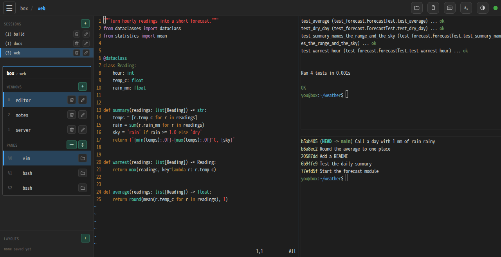
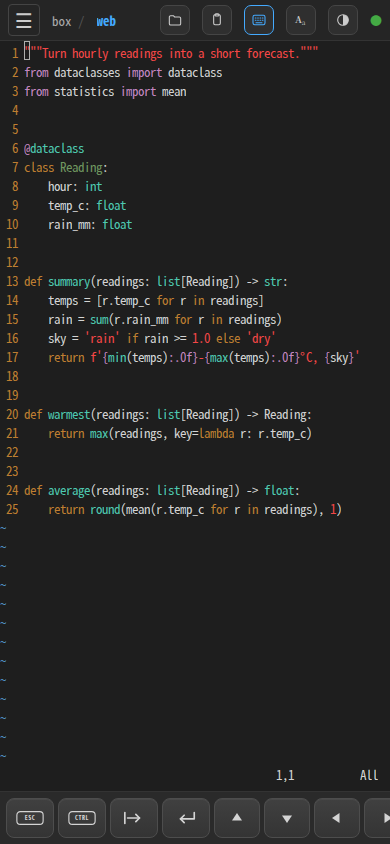
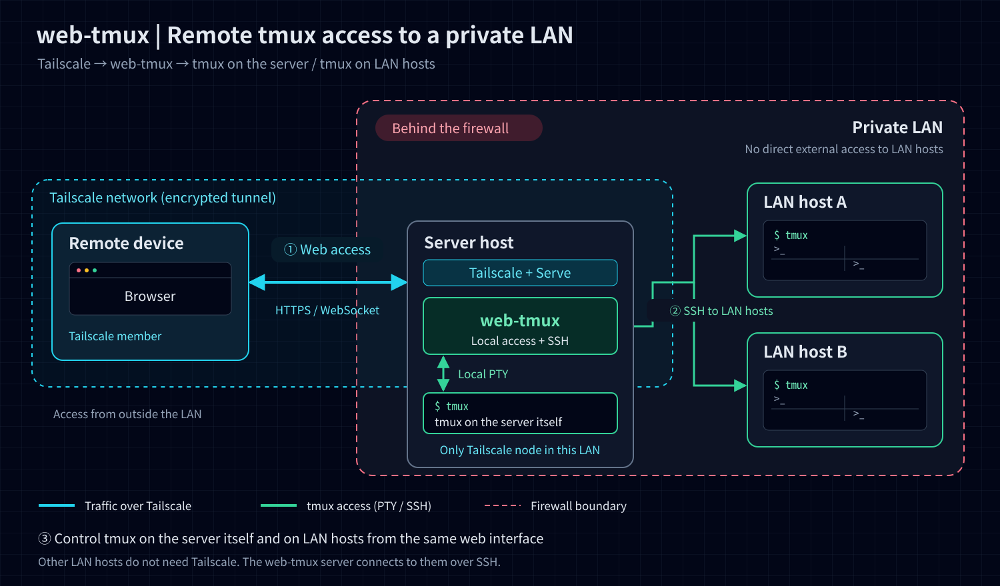

# web-tmux

Your tmux sessions in a browser — on your laptop, tablet or phone — reached privately over [Tailscale](https://tailscale.com).

[日本語](README.ja.md)

<p>
  
  
</p>

- **Every session, window and pane** in a sidebar: switch, split, rename, zoom, and save the whole layout to restore later
- **Made for phones and tablets too**: zoom any pane to full screen with a tap, Esc / Tab / Ctrl / arrow keys, Japanese and other IME input
- **Keeps an eye on coding agents**: Claude Code, Codex and Hermes Agent panes show whether they are working, waiting for you, or done
- **tmux on other machines** over SSH, from the same page, without putting them on your tailnet
- **Private by design**: only your own tailnet login gets in; nothing is open to the internet or the LAN

## Quick start

You need tmux, git, Python 3.10 or later (or [uv](https://github.com/astral-sh/uv)), and [Tailscale](https://tailscale.com/download) installed and connected on the machine that runs tmux. In the Tailscale [admin console](https://login.tailscale.com/admin/dns), MagicDNS and HTTPS certificates must be on (setup tells you if they are not).

```bash
curl -fsSL https://raw.githubusercontent.com/solab-tut/web-tmux/main/install.sh | bash
```

This installs the latest release into `~/web-tmux` and runs `./setup.sh`, which

1. builds the Python environment in `.venv`,
2. reads this machine's tailnet name and your login from `tailscale status`, shows them, and writes `.web-tmux.env` once you confirm,
3. offers to run the `tailscale serve` command that publishes web-tmux to your tailnet (on Linux with `sudo`).

Then start web-tmux and open the address it prints, from any device on your tailnet:

```bash
cd ~/web-tmux && ./server.sh
# Open  https://<machine>.<tailnet>.ts.net:8766/
```

The installer adds no packages and needs no `sudo` — only the optional `tailscale serve` step does, on Linux, and only after asking. If a tool is missing, the installer names it and the command to get it. Prefer to read the script first, or to use git yourself?

```bash
curl -fsSLO https://raw.githubusercontent.com/solab-tut/web-tmux/main/install.sh
less install.sh && bash install.sh
# or
git clone https://github.com/solab-tut/web-tmux.git && cd web-tmux && ./setup.sh
```

**Getting the prerequisites**

| System | Command |
|--------|---------|
| macOS | `brew install tmux git python`, and the [Tailscale app](https://tailscale.com/download/mac) |
| Ubuntu 22.04 or later | `sudo apt install tmux git python3 python3-venv`, and [Tailscale for Linux](https://tailscale.com/download/linux) |
| Ubuntu 20.04 | Python is 3.8 there: install [uv](https://docs.astral.sh/uv/getting-started/installation/), or Python 3.10 from the `deadsnakes` PPA (`python3.10 python3.10-venv`) |

**Updating:** run the same `curl … | bash` again (in a clone of your own, `git pull && ./setup.sh`), then `./server.sh restart`. Your `.web-tmux.env` is kept.

## Why Tailscale

web-tmux gives whoever opens it a shell, so it is never reachable directly. The server listens on `127.0.0.1` only, and [Tailscale Serve](https://tailscale.com/kb/1312/serve) brings it to your tailnet over HTTPS. Tailscale tells web-tmux who is asking, and web-tmux lets in only the logins listed in `.web-tmux.env` — no password to choose, no port to open on your router, and the same address works from home, the office or a phone on mobile data. Opening `http://127.0.0.1:8766` directly is refused on purpose.

```
Browser (xterm.js)  ←─HTTPS / WebSocket─→  tailscale serve  ─→  server.py  ←─PTY─→  tmux -CC
```

## Network architecture



This example places the web-tmux server inside a private LAN protected by a firewall:

1. A browser on a Tailscale-connected device accesses web-tmux through **Tailscale Serve** (HTTPS / WebSocket).
2. web-tmux controls **tmux on the server itself** through a local PTY, and connects over SSH to **tmux on other LAN hosts** or on an **external SSH server** outside the firewall (a VPS, say).
3. Only the server needs to join Tailscale inside the LAN. The other LAN hosts and external servers do not need Tailscale, and the browser connects only to web-tmux rather than directly to those hosts.

See [tmux on other hosts (SSH)](#tmux-on-other-hosts-ssh) for SSH host configuration.

## Features

- Sidebar showing sessions, windows, and panes with live updates
- Switch, rename, and delete sessions and windows inline
- Create new windows, sessions, and splits (horizontal / vertical)
- Pane zoom: click a pane in the sidebar to zoom in; click again to return to split view
- Terminal automatically resizes to match the browser viewport
- Color themes: Dark (default), Light, Nord
- Adjustable font size (11–18 px), persisted in `localStorage`
- Save every open session's shape (window names, split layout, each pane's working directory) to a named layout and restore it later
- Read-only file viewer: browse from a pane's working directory (top-bar folder icon, or the folder button on a pane in the sidebar) and read text files, with a rendered preview for Markdown, and images (PNG, JPEG, GIF, WebP, AVIF, BMP, ICO, SVG), including those a Markdown document shows from the same host. Works on SSH hosts too; text is cut at 200 KiB, images over 4 MiB are not shown, and only regular files open
- Coding agent status: a pane running Claude Code, Codex or Hermes Agent gets an icon in the sidebar — a prompt (`❯_`) when idle, a turning blue arc while thinking, a pulsing orange warning sign while it waits for you (an approval, or a choice such as Hermes's model picker), and a green check mark when a turn ended, until you type a key into that pane or, having had its window on screen, move to another window (a click or a scroll doesn't count). That holds while its window is on screen too, so a tab in the background or a desk left for a while still tells you. While any agent is waiting for you or finished, the ☰ button turns orange or green (and carries a small turning arc while any agent is working), and the tab's title (`⚠1 ✓2 …`) and icon say so too, for when the sidebar is closed or the tab is in the background. Window and session rows show the most pressing state among their panes. Other reachable SSH hosts are covered too, on their session rows, and count towards the ☰ button and the tab. The server reads the bottom of those panes' screens and matches what each agent prints (`esc to interrupt`, `Do you want to proceed?`, …), so nothing needs to be set up: every 2 seconds or so on the host being viewed, and every 10 seconds on the others while a browser is connected. A change in an agent's wording can throw it off
- **Mobile-friendly:** zoom a pane to full screen, virtual keyboard (Esc / Tab / Ctrl / Enter / arrows), IME support

## Running the server

Run these in the web-tmux directory (`~/web-tmux` after the quick start).

**Custom tmux session name** (default: `web`):

```bash
TMUX_SESSION=my-session ./server.sh
```

**Start / stop:**

```bash
./server.sh        # start (or restart if already running)
./server.sh start  # same as above
./server.sh restart # explicitly restart
./server.sh stop   # stop without restarting
```

`server.sh` only stops processes verified to be this checkout's server. On Linux, it can recover a missing or stale PID file by checking the process owner, working directory, and arguments in `/proc`. An unrelated PID is left alone; if another checkout or application occupies port 8766, startup aborts without killing it.

## Usage

### Sidebar

| Section | What you can do |
|---------|-----------------|
| **Sessions** | Click to switch; ✏ to rename; 🗑 to delete |
| **Windows** | Click to switch (zoomed windows unzoom automatically) |
| **Panes** | Click active pane → toggle zoom on/off; click another pane → zoom to it |
| **❯_ / ↻ / ✓ / ⚠** (icon at the start of a row) | A coding agent's state: idle, thinking, finished but not seen yet, waiting for you (approval or a choice). Hover for the agent and state |
| **+** (windows row) | New window in current session |
| **+** (sessions row) | New session (without ssh hosts; with them, use each host row's **+**) |
| **Host rows** (ssh hosts configured) | Click to fold / unfold that host's sessions |

Windows and Panes belong to the current session, so they sit together in one
framed block headed `host › session`.
| **⇿ / ⇕** | Split active pane horizontally / vertically |
| **Layouts** | Click to restore a saved layout; 🗑 to delete it |
| **+** (layouts row) | Save every currently open session under one named layout |

A layout is a snapshot of your whole workspace — every session that was open
when you saved it, each with its window names, how its panes are split, and
each pane's working directory. Commands that were running and what was on
screen are not saved; restoring gives you the same sessions and frames back,
with fresh shells in them. A working directory that no longer exists falls
back to `$HOME`.

Restoring recreates each session under the name it had when it was saved. If
any of those names are already running, you are asked whether to **Replace**
them, restore them **as copies** alongside the existing ones under free
names, **Skip existing** sessions and restore only the non-conflicting ones,
or **Cancel** — the choice applies to all of the conflicting sessions at
once. Sessions that don't conflict are restored with any restore choice. Each
session is built under a throwaway name first, so a failure restoring one of them
never disturbs the others or your existing sessions; a note in the sidebar
says if any session couldn't be restored.

Layouts live in `~/.local/share/web-tmux/layouts.json` (see
[Security notes](#security-notes)).

### Theme and font size

Click the **◑** (theme) or **Aa** (font size) icons in the top-right corner to open a dropdown. Both settings are saved in `localStorage` and restored on the next visit.

| Theme | Description |
|-------|-------------|
| Dark  | VS Code Dark-inspired dark theme (default) |
| Light | Light background theme |
| Nord  | Nordic colour palette dark theme |

Font size options: 11, 12, 13, 14, 16, 18 px.

### Copying from mouse-aware apps

Apps that take over the mouse (Claude Code's fullscreen view, vim with `mouse=a`, tmux copy-mode) copy into a tmux paste buffer instead of the browser's selection. web-tmux forwards each new paste buffer to the OS clipboard of the browser that has focus. Chrome and Edge accept the write directly; if the browser refuses it (Safari, Firefox), a **Copy N characters** button appears at the bottom right for 10 seconds — click it to finish the copy. Buffers over 128 KiB are not forwarded.

### Mobile

On screens ≤ 768 px wide:

- A split window is shown as it is; tap a pane in the sidebar to zoom it to full screen, and tap it again to go back
- Tap the **☰** button to open / close the sidebar
- The top-bar **Paste** icon opens a paste sheet. Long-press its text area, paste, then tap **Send to terminal**

The **bottom toolbar** (virtual keys for `esc`, `tab`, `ctrl`, `enter`, and the arrow keys) is shown automatically on touch-capable devices regardless of screen width. Because detection is based on touch input rather than the user agent, it also covers iPads using iPadOS's desktop-style user agent. The keyboard icon in the top bar offers three modes, saved for the next visit:

- **Auto** — show on touch devices or at widths of 768 px or less (default)
- **On** — always show
- **Off** — always hide

Enable the `ctrl` toggle to apply Ctrl to the next character. This setting controls web-tmux's virtual-key toolbar, not the iOS / iPadOS software keyboard itself.

On iOS / iPadOS the software keyboard carries an AutoFill bar above it, showing key, card and location icons. It is not specific to password fields: it appears whenever a form control has focus, and the terminal focuses xterm.js's hidden `<textarea>`. **A page cannot suppress it** — only a native `WKWebView` host can override `inputAccessoryView`, and no device setting turns it off. `static/app.js` already sets `autocomplete="off"`, which WebKit ignores. Twelve shapes were tried on an iOS 26 device — a wrapping `<form>`, several `input` types, `contenteditable`, several `inputmode` values, off-screen placement — and the bar stayed up for all of them.

When iOS has discarded a tab, Safari brings it back as a history navigation, and WebKit then leaves the browser showing "loading" indefinitely even though the page is complete and nothing is pending. Once the connection is up, such a tab reloads itself as an ordinary navigation, which the service worker answers from its cache without touching the network. Set `RENAVIGATE_RESTORED_TABS = false` in `static/app.js` to keep the restored tab instead and live with the indicator.

## tmux on other hosts (SSH)

web-tmux can also attach to tmux running on other machines — including LAN
machines that are not on your tailnet, reached through a tailnet node with
`ProxyJump`. The browser still only talks to this server; this server runs
`ssh <alias> tmux -CC` and the remote tmux shows up in the sidebar like a
local one, with its windows, panes, scrollback and saved layouts. Sessions
keep running on the remote host when the browser, this server, or the ssh
connection goes away.

**1. Describe how to reach each host in the server user's `~/.ssh/config`.**
Any of these ways to authenticate works:

- a key without a passphrase (simplest; a dedicated one is recommended);
- a key in an ssh-agent — `server.sh` passes on `SSH_AUTH_SOCK`, from your
  login shell or from `.web-tmux.env`;
- a key with a passphrase, or a password: web-tmux asks for it in the
  browser (see *Signing in* below).

```
Host gw-home                      # a tailnet node inside the LAN
  HostName gw-home.tailnet-name.ts.net
  User me
  IdentityFile ~/.ssh/web-tmux_ed25519
  IdentitiesOnly yes

Host lan-box                      # LAN only, not on the tailnet
  HostName 192.168.1.20
  User me
  ProxyJump gw-home
  IdentityFile ~/.ssh/web-tmux_ed25519
  IdentitiesOnly yes
```

**2. Connect once by hand** so both hops are in `known_hosts` — web-tmux
never accepts an unknown host key (`StrictHostKeyChecking=yes`), it just
reports the host as unreachable:

```bash
ssh lan-box tmux -V
```

**3. List the aliases** in `.web-tmux.env` and restart:

```bash
WEB_TMUX_SSH_HOSTS=lan-box,mac-mini:/opt/homebrew/bin/tmux
```

Only these aliases can ever be used; the browser picks from them and cannot
name a host of its own. `alias:/path` sets the tmux binary when it is not on
the PATH of a non-interactive ssh login (e.g. Homebrew on macOS). OpenSSH
8.4 or newer is needed on this machine for signing in from the browser.

**Using it.** With hosts configured, the session list is grouped by host,
each with a status dot after its name, a **+** for a new session there, and
**↻** to retry an unreachable host. Picking a session on another host moves the server's
control client there — every open browser follows, since they all watch the
same one — and the top bar shows `server → alias` while you are on a remote
host. If the connection to that host is lost and cannot be re-established,
web-tmux falls back to the local session and says so. Saving a layout
captures the sessions of every host that answers (a host that doesn't is
left out, and the note says which); restoring rebuilds each session on its
own host, never switches you to another host, and reports per session when a
host can't be reached.

**Signing in.** A host that needs a passphrase or password shows 🔑 in the
list. Click it — or just pick that host's **+** or a session on it — and the
browser that clicked gets ssh's own prompt (`Enter passphrase for key …`,
`me@lan-box's password:`), one per hop when a ProxyJump host asks too. The
answer goes from the WebSocket straight to ssh through `SSH_ASKPASS`; it is
never stored or logged. Cancel stops the sign-in. Once signed in, the shared
connection is kept for 8 hours after its last use, so nothing is asked again
until then — or until web-tmux stops or restarts: it closes its ssh
connections on the way out, and on start closes any that a killed server
left behind.
Background refreshes of the session list never ask anyone: a host that
needs a password just shows 🔑 until someone signs in.

**Disconnecting.** A connected remote host also has a broken-link button. It
closes the shared ssh connection to that host; if the control client is on
that host, every browser is first moved back to the local session. The tmux
sessions on the host keep running. A disconnected host shows a grey dot and
is not checked in the background until someone presses its link button to
connect (asking for a passphrase or password if needed). The disconnect lasts
until web-tmux restarts.

**Remote requirements:** tmux 3.2 or newer (with 3.2/3.3 the prefix key is
passed through to the pane instead of triggering tmux bindings), a POSIX
login shell (sh/bash/zsh; not fish), and a UTF-8 capable system. Attaching
sets the remote tmux server's global `window-size latest` and
`history-limit 50000`, as it does locally.

All ssh calls to a host share one connection (`ControlMaster`, kept for 10
minutes), with sockets and a per-host ssh log in
`~/.local/share/web-tmux/ssh/`.

## Manual setup

`./setup.sh` does all of this for you. This section says what it does, for setting it up by hand or changing it later. `./setup.sh` can be run again at any time and keeps an existing `.web-tmux.env`; `./setup.sh --yes` answers yes to its questions, for scripts.

### Python environment

If [uv](https://github.com/astral-sh/uv) is installed, `setup.sh` runs `uv sync --frozen` from `uv.lock`. Otherwise it uses an existing Python 3.10+ with `venv` + `pip` and `requirements.txt`. It never downloads uv itself. The browser terminal assets are vendored under `static/vendor/`, so the app needs no CDN at runtime.

### `.web-tmux.env`

`setup.sh` writes this file from `tailscale status`: this machine's HTTPS address on your tailnet, and the login of the machine's owner. To write it yourself, copy `.web-tmux.env.example`, keep its mode at 600, and set:

```dotenv
WEB_TMUX_ALLOWED_ORIGINS=https://<machine>.<tailnet>.ts.net:8766
WEB_TMUX_TAILSCALE_USERS=you@example.com
```

`server.sh` refuses to load `.web-tmux.env` unless its mode is exactly 600. It takes `WEB_TMUX_*` settings from that file only and ignores any in the shell's environment, so a setting exported for another checkout cannot leak into this server. The server also fails closed when the origin list is empty or a remote origin has no allowed Tailscale login. Do not add localhost or `127.0.0.1`: browser access is intended to go through Tailscale Serve only.

| Variable | Meaning |
|----------|---------|
| `WEB_TMUX_ALLOWED_ORIGINS` | Comma-separated exact-match list of allowed HTTP origins |
| `WEB_TMUX_TAILSCALE_USERS` | Comma-separated exact-match list of allowed `Tailscale-User-Login` values |
| `WEB_TMUX_SSH_HOSTS` | Optional: tmux on other machines (see [tmux on other hosts](#tmux-on-other-hosts-ssh)) |
| `WEB_TMUX_STATE_DIR` | Optional: where saved layouts live (default `~/.local/share/web-tmux`) |

To let a second person in, add their login to `WEB_TMUX_TAILSCALE_USERS`. On a [tagged](https://tailscale.com/kb/1068/tags) machine `setup.sh` cannot tell who owns it, and asks. Restart the server after editing `.web-tmux.env`:

```bash
./server.sh restart
```

### `tailscale serve`

web-tmux listens on one local port, `127.0.0.1:8766`: the page and its files over HTTP, and the terminal over a WebSocket on `/ws`. `tailscale serve` exposes that port to your tailnet over HTTPS, and the browser then connects to the WebSocket with `wss://`. web-tmux checks the exact browser origin and the `Tailscale-User-Login` identity header before issuing a signed session cookie.

```bash
tailscale serve --bg --https=8766 http://127.0.0.1:8766
```

> **Linux:** `tailscale serve` requires `sudo` (unless your user was made tailscaled's operator). On macOS it typically does not.

`./server.sh` reads `tailscale serve status` when it starts (no `sudo` needed for that) and warns if this forwarding is missing. To check it yourself:

```bash
tailscale serve status
```

```
https://<machine-name>.<tailnet>.ts.net:8766/ (tailnet only)
|-- / proxy http://127.0.0.1:8766
```

To stop publishing web-tmux:

```bash
tailscale serve --https=8766 off
```

### Troubleshooting

- **The page says "this address or Tailscale user is not allowed here".** `server.log` names the reason: `host not allowed` means the address you opened is not in `WEB_TMUX_ALLOWED_ORIGINS`; `tailscale user not allowed` means your login is not in `WEB_TMUX_TAILSCALE_USERS`; `missing tailscale identity` means the request did not come through `tailscale serve` (or came from a tagged device, which has no user).
- **The page does not load at all.** Check that `./server.sh` printed `server started` and that `tailscale serve status` shows the forwarding above.
- **The page loads but the terminal never connects.** Reload once; a tab opened before an update may still run the old page.
- `curl -I` gets no answer: web-tmux serves `GET` only. Use `curl -s -o /dev/null -w '%{http_code}\n' <URL>`.

### Upgrading from two ports

Earlier versions also served the WebSocket on port 8765. After updating, remove that forwarding — `./server.sh` reminds you while it is still there:

```bash
tailscale serve --https=8765 off
```

A browser tab still running the old page cannot reach the terminal; reload it once.

### Public access (Tailscale Funnel)

**Do not enable Funnel for web-tmux.** The application is designed for a private, owner-only Tailnet. Internet exposure and multi-user authorization are outside its security model.

## Security notes

- The server binds to `127.0.0.1` only, and the allowed origin configuration excludes localhost, so browser access must go through Tailscale Serve. Loopback binding is a host boundary, not a user boundary: another local Unix user can forge proxy headers, so this deployment model assumes a personal machine without untrusted local users.
- HTTP and WebSocket requests require an allowed Host/origin. Tailnet requests also require an allowed `Tailscale-User-Login`.
- After validating the Tailscale identity, `GET /auth/session` automatically issues an HttpOnly, SameSite=Strict, HMAC-signed cookie, valid for 30 days. The page asks for it on first load, renews it from a connection that has already been up for a while, and asks again when a handshake is rejected — for instance after a server restart, which mints a new signing secret. Reconnects, including the ones after a phone wakes up, reuse the cookie and make no HTTP request at all. Tailnet HTTPS cookies also carry the Secure attribute.
- Missing origins, mismatched hosts, invalid cookies, and unauthorized users are rejected before tmux state is generated. Tagged Tailscale devices without an identity header cannot connect.
- WebSocket traffic is limited to eight connections, 64 KiB per message, and 8 KiB per input message, with compression disabled. Control rate, input rate, and outbound queues are also bounded.
- HTTP responses include CSP, frame-embedding protection, MIME-sniffing protection, Referrer Policy, and a restricted Permissions Policy.
- A service worker (`static/sw.js`) caches the app shell and answers the document request the browser makes on its own when it re-creates a discarded tab, so that load never waits for the network. It never touches `/auth/session`, and the cache holds nothing but the shell — terminal contents only ever travel over the WebSocket, which stays fully authenticated. A browser that is no longer authorized can still open the cached shell, but it cannot connect.
- Only the cookie-issuing response is `no-store`. The app shell is revalidated on every use and the versioned files under `/vendor/` are cached, so a browser can restore the page without going back to the network — none of it contains terminal data or secrets.
- Invalid origins, identities, messages, and rate-limit violations are recorded in `server.log` without terminal input or cookie values. The page also reports a short connection diagnostic there when it reconnects (`client ...`), carrying only connection state — no terminal data. Set `CLIENT_DIAGNOSTICS = false` in `static/app.js` to turn it off.
- Saved layouts are written to `~/.local/share/web-tmux/layouts.json` with mode 600 inside a mode 700 directory. They record working-directory paths, so treat the file as private; it never leaves the machine and is not part of the repository.
- Keep `tailscale serve status` limited to the tailnet-only listener shown above.
- With `WEB_TMUX_SSH_HOSTS` set, anyone who gets into web-tmux (an allowed Tailscale identity, or a stolen session cookie) gets a shell on every listed host and on the jump hosts in between. Restricting the key with `command=` does not help — tmux itself can run anything — but `restrict,pty,from="<this server's tailnet IP>"` in each remote `authorized_keys` keeps the key from being used elsewhere or for forwarding. ssh runs with agent and X11 forwarding off and all configured forwardings cleared. The ssh socket directory is mode 700. Passphrases and passwords typed in the sign-in dialog only travel over the authenticated WebSocket to a mode-600 socket and on to ssh; they are never written to disk or logs, and only the browser that started a sign-in can answer its prompts. ssh runs without a controlling terminal and with an askpass that refuses everything outside a sign-in. Remote error text is logged (shortened, one line) but never sent to the browser, and terminal contents are not logged.

## Third-party browser assets

- `xterm@5.3.0`
- `xterm-addon-fit@0.8.0`
- `xterm-addon-unicode11@0.4.0`
- `markdown-it@14.1.0` (its bundled dependencies' licenses, including
  `entities` under BSD-2-Clause, are in `THIRD_PARTY_LICENSES` next to it)

These assets are distributed under the MIT license. Their license files are
included next to the vendored files in `static/vendor/`.

## File layout

```
web-tmux/
├── server.py             # HTTP + WebSocket server
├── web_security.py       # Origin, Host, identity, and signed-cookie checks
├── tmux_control.py       # tmux -CC control-mode wrapper
├── askpass.py            # ssh passphrase/password prompts answered from the browser
├── tmux_hosts.py         # Local / ssh hosts: tmux argv, ssh master, host list
├── layout_parser.py      # tmux layout string parser
├── layout_store.py       # Saved session layouts: capture, restore plan, store
├── agent_status.py       # A coding agent's state, read off its pane's screen
├── tests/                # Unit tests: .venv/bin/python -m unittest
├── pyproject.toml        # Python project and pinned dependency
├── uv.lock               # Lock file for uv
├── requirements.txt      # Pinned dependency for venv + pip
├── .web-tmux.env.example # Tailnet configuration example
├── tailscale_setup.py    # Reads Tailscale for setup.sh and server.sh
├── install.sh            # One-command install / update (clones, runs setup.sh)
├── setup.sh              # Python environment, .web-tmux.env, tailscale serve
├── server.sh             # Start / stop the server
└── static/
    ├── index.html
    ├── style.css
    ├── app.js
    ├── sw.js             # serves the app shell to restored tabs, offline
    └── vendor/          # vendored xterm.js runtime assets and licenses
```

Saved layouts live outside the repository, in
`~/.local/share/web-tmux/layouts.json` (override the directory with
`WEB_TMUX_STATE_DIR` in `.web-tmux.env`).

## Tests

After running `setup.sh`, run the test suite with the project virtual environment:

```bash
.venv/bin/python -m unittest -v
.venv/bin/python -m unittest tests.test_server   # one module
```

The tests live in `tests/`; nothing in them is needed to run web-tmux.

## Logs

```bash
tail -f server.log
```

`server.log` is recreated at startup with mode 600. Rejection reasons are logged, but terminal contents, input data, and cookie values are not.
